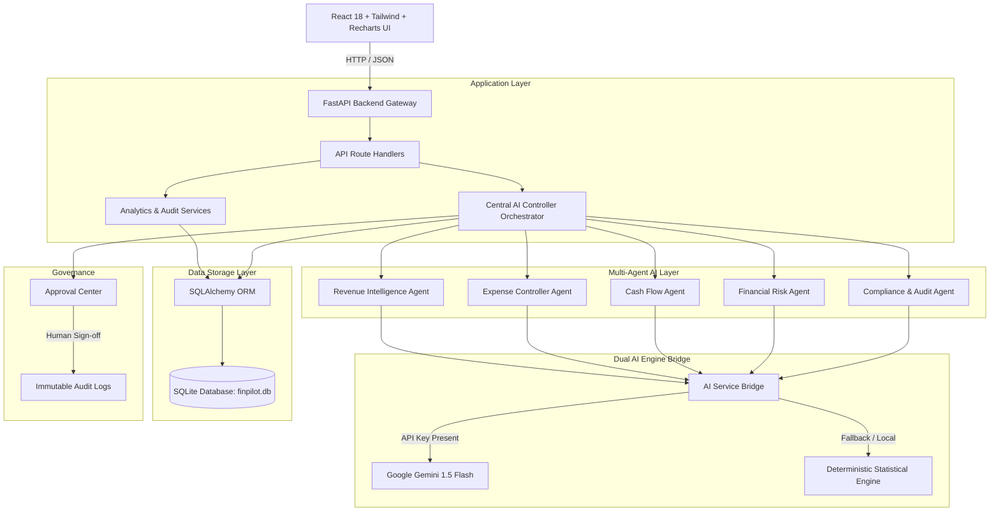
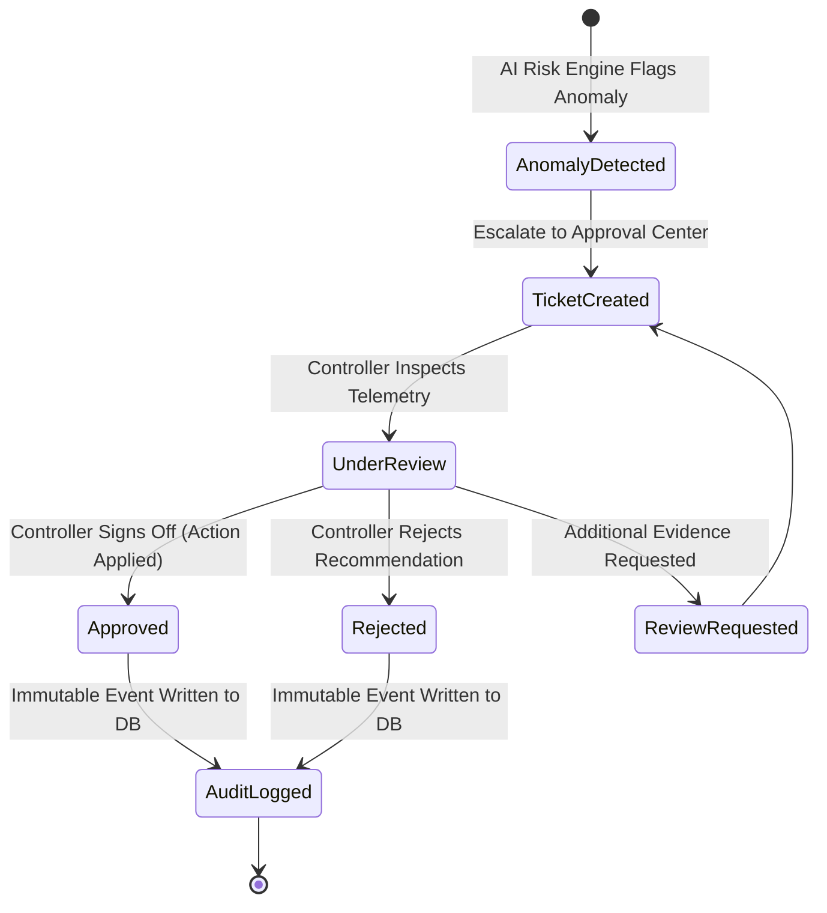

# FinPilot AI — Architecture Specification

This document details the architectural design, agent coordination protocols, data schema, risk scoring algorithms, and governance workflows of **FinPilot AI**.

---

## 1. System Topology

---

## 2. Specialized AI Agents & Domain Responsibilities

| Agent | Responsibilities | Key Equations / Heuristics |
| :--- | :--- | :--- |
| **Agent 1: Revenue Intelligence** | Top revenue streams, growth percentages, account concentration, velocity drops. | $\text{Growth \%} = \frac{\text{Rev}_{\text{current}} - \text{Rev}_{\text{previous}}}{\text{Rev}_{\text{previous}}} \times 100$ |
| **Agent 2: Expense Controller** | Category burn tracking, budget variances, duplicate detection (same vendor + exact amount $\le 48\text{h}$). | $\text{Variance \%} = \frac{\text{Actual} - \text{Budget}}{\text{Budget}} \times 100$ |
| **Agent 3: Cash Flow** | Opening/closing cash positions, 30-day forecast, reserve breach alert day $D_{\text{breach}}$. | $\text{Closing Cash} = \text{Opening} + \text{Inflows} - \text{Outflows} - \text{Refunds}$ |
| **Agent 4: Financial Risk** | 0–100 transaction anomaly score, ticket multiple vs historical customer mean, mandate failure bursts. | $\text{Score} = \text{Base} + f(\text{Multiple}) + f(\text{Failures}) + f(\text{Refunds})$ |
| **Agent 5: Compliance & Audit** | Relational consistency, missing customer IDs on high-value settlements, tamper-proof audit trails. | Integrity Score 0–100 with deduction for unlinked KYC or duplicate IDs. |

---

## 3. Financial Risk Scoring Mathematical Formula

For any individual transaction $T$:
1. **Customer Baseline Comparison**:
   $$\text{Multiple} = \frac{\text{Amount}(T)}{\text{AvgTicket}(\text{Customer})}$$
   - If $\text{Multiple} \ge 3.5 \implies +45 \text{ points}$
   - If $\text{Multiple} \ge 2.0 \implies +20 \text{ points}$
2. **Payment Failure History**:
   - $\ge 3 \text{ preceding failures} \implies +30 \text{ points}$
3. **Refund Ratio on Account**:
   - $\ge 2 \text{ prior refunds} \implies +25 \text{ points}$
4. **Absolute High-Value Threshold**:
   - If $\text{Amount}(T) \ge ₹2,50,000 \implies +25 \text{ points}$
5. **Clamping**:
   $$\text{Final Score} = \min(100, \max(5, \text{Raw Score}))$$

### Risk Tiers
- **0 – 30**: `LOW` (Standard transaction flow)
- **31 – 60**: `MEDIUM` (Automated monitoring enabled)
- **61 – 80**: `HIGH` (Secondary review recommended)
- **81 – 100**: `CRITICAL` (Mandatory pre-settlement hold / approval escalation)

---

## 4. Human-in-the-Loop Governance State Machine

---

## 5. Database Relational Model

- `users`: Controller identity and role definitions.
- `customers`: Customer accounts, KYC tiers, lifetime spend, average order value.
- `transactions`: Payments with amounts, statuses (`SUCCESS`, `FAILED`, `REFUNDED`, `PENDING`), risk scores, AI flags, and telemetry signals.
- `expenses`: Disbursements by category, vendor, amount, status, and AI risk tag.
- `budgets`: Category caps, revenue targets, and configured minimum cash reserve.
- `risk_alerts`: System-wide anomaly records with resolution state history.
- `ai_insights`: Executive synthesized findings across domain categories.
- `approvals`: Human-in-the-loop decision tickets.
- `audit_logs`: Append-only, immutable historical event log.
- `app_settings`: Global business bounds, currency, and risk sensitivity parameters.
