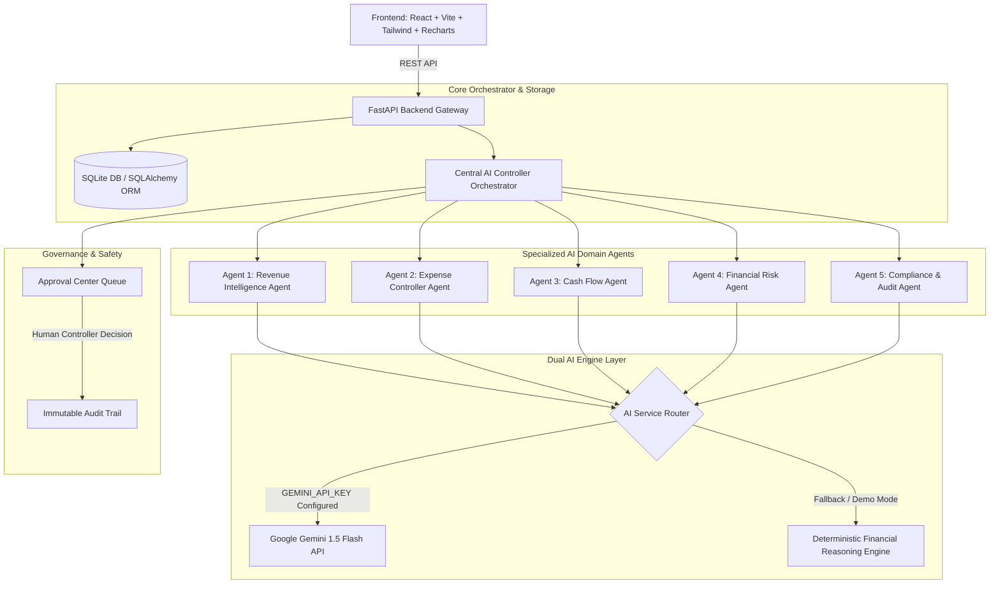

# FinPilot AI — Autonomous AI Finance Controller

> **Your Autonomous AI Finance Controller**  
> *Submission for Razorpay AI Builder Internship 2026 — Track 4: AI Finance Controller*

---

## 🌟 Executive Overview

**FinPilot AI** is a production-style, autonomous financial intelligence platform engineered for modern businesses. Moving beyond static CRUD tables, FinPilot continuously inspects business transactions, vendor outlays, cash flows, and compliance ledgers using a **coordinated Multi-Agent AI architecture**.

Every computation and AI diagnosis is **anchored directly in verified ledger data**—preventing hallucinations while providing actionable, plain-language financial guidance and human-in-the-loop safety controls.

---

## 🎯 Track 4 Alignment: How FinPilot Fits the AI Finance Controller Track

| Track 4 Requirement | FinPilot AI Implementation |
| :--- | :--- |
| **Autonomous Monitoring** | 5 specialized domain agents continuously evaluate revenue, costs, cash runway, payment failure loops, and anomaly scores without manual intervention. |
| **Multi-Agent Architecture** | Dedicated agents for Revenue, Expenses, Cash Flow, Financial Risk, and Compliance/Audit orchestrated by a central AI Controller. |
| **Zero-Hallucination Grounding** | All metrics, variances, and forecasts are computed strictly from real SQLite ledger tables before being synthesized by the AI. |
| **Risk Scoring & Anomaly Detection** | Real-time 0–100 risk scoring engine with statistical ticket z-scores, velocity checks, mandate failure tracking, and refund ratio alerts. |
| **Human-in-the-Loop Governance** | High-impact actions (pre-settlement holds, budget adjustments) are routed to the **Approval Center** for human review before execution. |
| **Dual AI Execution Engine** | Seamless support for **Google Gemini 1.5 Flash** with an automatic, deterministic **Rule & Statistical Engine fallback** (Demo AI Mode) if no API key is provided. |
| **Immutable Audit Trail** | Every automated AI flag, human approval, risk resolution, and budget alteration produces an immutable audit record. |

---

## 🤖 Multi-Agent Architecture



### The 5 Specialized AI Agents

1. **Revenue Intelligence Agent**: Analyzes top revenue drivers, period-over-period growth percentages, subscription trends, and detects abrupt velocity drops.
2. **Expense Controller Agent**: Categorizes operating expenses, detects category budget overruns, detects duplicate invoices within 48-hour windows, and flags cost-saving opportunities.
3. **Cash Flow Forecast Agent**: Computes daily liquidity burn rates, provides 30-day forward forecasts, and triggers predictive alerts when closing cash threatens minimum reserve thresholds.
4. **Financial Risk Agent**: Evaluates transactions on a 0–100 risk score (`LOW`, `MEDIUM`, `HIGH`, `CRITICAL`), detects anomalous ticket sizes (e.g. 5.8x customer baseline), mandate failure bursts, and refund spikes.
5. **Compliance & Audit Agent**: Performs relational integrity checks, flags unlinked customer high-value payments, prevents ID collisions, and logs immutable audit trails.

---

## 🚀 Key Features

- 📊 **Executive Fintech Dashboard**: Real-time KPI cards (Revenue, Expenses, Net Profit, Cash Balance, Receivables, Risk Score) with date range filters (`7D`, `30D`, `90D`, `6M`, `1Y`) and interactive Recharts.
- 🔍 **AI Transaction Analyzer**: Deep forensic diagnostic modal for individual transactions showing risk score, signal breakdown, diagnostic reasoning, and simulated action controls (`ALLOW`, `MONITOR`, `MANUAL_REVIEW`, `BLOCK`).
- 💳 **Expense & Budget Controller**: Category budget tracking with variance meters and automatic duplicate invoice detection.
- 📈 **30-Day Predictive Cash Flow**: Forward liquidity modeling with a visual threshold boundary for configured minimum cash reserves.
- 🛡️ **Financial Risk Center**: Grouped threat alerts (`CRITICAL`, `HIGH`, `MEDIUM`, `RESOLVED`) with one-click escalation to human approvals.
- 💬 **FinPilot Copilot**: Conversational natural-language interface providing substantiated answers with supporting numbers and cited agent sources.
- ⚖️ **Human-in-the-Loop Approval Queue**: Mandatory review gates for high-risk operations.
- 📜 **Tamper-Proof Audit Trail**: Complete historical record of controller actions and AI events.
- 📑 **Print-Ready Executive Dossier**: Board-ready financial summary with instant PDF/print layout.

---

## 🛠️ Tech Stack

- **Backend**: Python 3.10+, FastAPI, SQLAlchemy, SQLite, Pydantic v2, Uvicorn, Requests / HTTPX, Pytest.
- **Frontend**: React 18, Vite, Tailwind CSS, Recharts, Lucide React, Clsx.
- **AI Layer**: Google Gemini 1.5 Flash REST API bridge + Deterministic Rule & Statistical Engine.

---

## 💻 Installation & Quick Start

### Prerequisites
- Python 3.10 or higher
- Node.js 18 or higher & npm

### 1. Backend Setup

```bash
cd backend

# Create and activate virtual environment (optional but recommended)
python -m venv venv
# On Windows:
.\venv\Scripts\activate
# On macOS/Linux:
source venv/bin/activate

# Install dependencies
pip install -r requirements.txt

# (Optional) Add your Gemini API key in backend/.env:
# GEMINI_API_KEY=your_key_here
# If omitted, FinPilot seamlessly runs in Deterministic Demo AI Mode!

# Start FastAPI server
uvicorn app.main:app --reload --port 8000
```
Backend API will be available at: `http://localhost:8000` (API Docs at `http://localhost:8000/docs`).

### 2. Frontend Setup

```bash
cd frontend

# Install dependencies
npm install

# Start Vite development server
npm run dev
```
Frontend UI will be running at: `http://localhost:5173`.

---

## 🎬 Recommended Evaluator Demo Flow

Follow these steps for a complete walkthrough of FinPilot AI:

1. **Open Dashboard (`http://localhost:5173`)**: Observe the 6 real-time KPI cards and interactive charts.
2. **Review AI Insights Banner**: Click on the prominent banner to see the **Marketing Budget Overrun (+24%)** insight.
3. **Open Risk Center**: Review the **Critical Risk Alert** on `txn_9901_CRITICAL` (₹3,85,000 anomaly from Nexus Global Exports).
4. **Deep AI Transaction Analysis**: Click **Analyze with AI** on the transaction to view the statistical anomaly multiple (5.8x above customer average) and detected telemetry signals.
5. **Escalate to Approval Center**: Click **Escalate to Approval Center** to dispatch a pre-settlement hold request.
6. **Human Sign-off in Approval Center**: Open the **Approval Center**, review the ticket, and click **Approve Action**.
7. **Verify Audit Trail**: Open **Audit Logs** to confirm that the human approval and status change were immutably recorded.
8. **Test Finance Copilot**: Open **Finance Copilot** and ask:
   - *"Why is our cash flow under pressure?"*
   - *"Why did profit decrease this month?"*
   - Observe how the AI provides substantiated figures, diagnostic reasoning, and cited agents.
9. **Generate Financial Report**: Navigate to **Financial Reports** and click **Export / Print PDF** to view the clean executive dossier.

---

## 🧪 Running Automated Tests

Run the test suite covering financial math, risk scoring, budget variance, and API endpoints:

```bash
cd backend
pytest -v
```

---

## 🔒 Security & Safe Simulation Disclaimers

- **Zero Gateway Risk**: Transaction blocks and approval decisions modify local application states only; no live bank or gateway funds are altered.
- **Safe Secrets**: No API keys are embedded in source code or sent to client browsers.
- **Demo Data Indicator**: Demo transactions are labeled and structured in Indian Rupees (₹) to tell a coherent business story for "Saroha Cloud Innovations Pvt Ltd".
